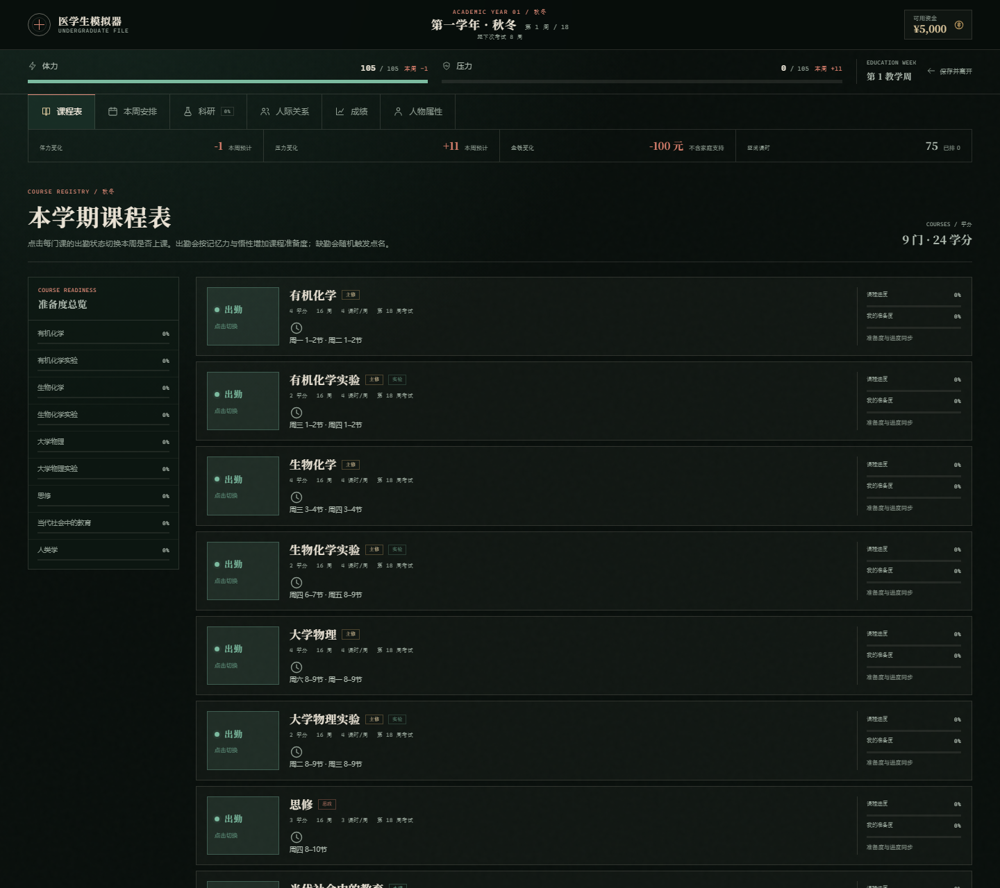
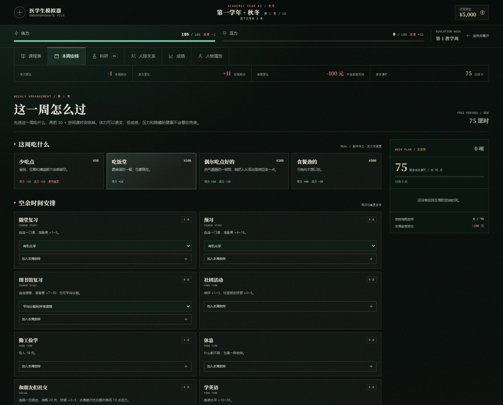

# 医学生模拟器 · 白袍之前与本科第一学期

一款从本科到博士的文字回合制医学生模拟游戏。一回合 = 一周：上课、翘课、科研、打工、吃饭、随机事件与考试，最终走向毕业、延毕或肄业。

当前版本包含两段内容：

1. **序章「白袍之前」**：从封面建立新生档案，到领取录取通知书、经历报到日，最终将学籍归档。
2. **本科核心 v0.5**：正式开局、第一学年秋冬选课（主修 / 思政 / 水课 / 选修）、18 周课表、出勤、三餐、空余时间、隐藏健康与副业、商店、基础科研、人际关系与每周事件、期末考试、GPA 与退学结局。

界面采用深夜值班室般的深色医学档案风格。

> 在线试玩：
> https://dbyzljx.github.io/medical-student-simulator/
>
> 注意：当前线上版本需要重新上传本目录后才会包含本科核心。直接打开 `game.html` 进入本科。




## 本科核心 v0.5

### 现在可以玩到什么

- 从序章归档页进入本科；首次进入先完成第一学期选课。
- 第一学年秋冬 18 周：两个 8 周教学块 + 第 9 / 18 周复习考试周。
- 主修、思政、水课、选修四类课程选课；主修课按学分和实验课时生成每周课表，可选具体节次。
- **20 门选修课已全部接入**，均为 8 周、第 9 周考试；《自媒体发展与实践》2 学分 / 16 周，《博弈论》3 学分 / 16 周。
- 每门课切换出勤 / 翘课；出勤按记忆力与悟性提升准备度；翘课触发点名，三次直接挂科。
- 每周选择三餐，安排 30 + 空闲课时的活动；开始本周后结算体力、压力、金钱、健康与副业。
- 隐藏健康：生病、重病、药物、课程/科研效率下降；隐藏副业：发展、收入、长期中断后回落。
- 商店：对症药物、能量饮料、助眠香薰。
- 基础科研：医学世家开局教授导师与课题、每周实验室干活、导师指导、文章等级与发表。
- 三人舍友 + 导师 + 社团朋友；好感、每周随机事件、聚餐/剧本杀选择、表白、恋人事件与恋爱矛盾。
- 第 9 周结算 8 周课程；第 18 周结算 16 周课程，产生成绩、学分与 GPA。
- 退学按钮，以及压力超过上限累计两次触发的退学结局。
- 自动写入 `medsim.save.v1`；从封面可继续本科。

### 当前边界

- 当前只完成到第一学年秋冬学期末；春夏学期、假期、临床轮转和五年升学线尚未接入。
- 人类学同时出现在旧水课目录与新的选修目录中，本版按新目录归为**选修课**，避免同一门课重复计入两类学分。
- 选修课总学分 30.5，毕业要求为 10 学分；课表页会按每周 78 课时容量校验。
- 小测/作业目前是按你给定的权重结构自动模拟，尚未做逐周交互。
- 休学住院、转专业、转行、奖学金、保研/考研、硕士/博士尚未接入。
- 普通玩家通过课程优秀触发导师招募也尚未接入；目前只有医学世家能直接进入实验室。
- 完整规则、临时公式和未完成清单见 **[GAME_RULES.md](GAME_RULES.md)**。



## 序章与角色创建

- 六步建档：姓名 → 天资 → 属性 → 家庭 → 初始能力 → 院校 → 核对
- 姓名可留空；留空时全文以「你」称呼，录取通知书和证书同样处理
- 实时学籍档案侧栏，随选择更新
- 完整规则校验：属性点必须用完、单项 3–10 点、能力点不可超上限
- 六种家庭背景、四种院校，以及各自的经济、导师/科研与竞争规则
- 清北院校线：GPA 优秀线 / 保研线 3.8，并展示国奖、省奖、校奖与励志奖学金门槛
- 录取通知书、学校/家庭专属报到叙事、学籍归档页
- 自动保存草稿；刷新或离开后可继续建档
- 深色临床档案主题；桌面端、平板与手机端适配

## 人物卡内容

### 天资

| 天资 | 开局属性点 | 能力点 | 每学年成长点 |
| --- | --- | --- | --- |
| 普通 | 30 | 5 | +2 |
| 优秀 | 35 | 8 | +3 |
| 精英 | 40 | 12 | +4 |
| 天才 | 50 | 16 | +6 |

每项属性最少投入 3 点，上限 10 点。

### 家庭背景

| 家庭 | 开局资金 | 周期支持 | 特殊规则 |
| --- | --- | --- | --- |
| 孤儿 | ¥200 | 每 4 周 +¥500 | 餐费全免，政府补助 |
| 贫穷家庭 | ¥1,000 | 申请后每 4 周 +¥500 | 每次开学可申请助学金；获批后餐费全免，部分事件选项受限 |
| 工薪阶层 | ¥5,000 | 每 4 周 +¥2,000 | — |
| 富裕家庭 | ¥10,000 | 每 4 周 +¥3,000 | — |
| 医学世家 | ¥5,000 | 每 4 周 +¥2,000 | 开局解锁导师与科研 |
| 家财万贯 | ¥100,000 | 每 4 周 +¥50,000 | — |

### 初始能力

| 能力 | 消耗 | 效果 |
| --- | --- | --- |
| 乐天派 | 2 点 | 压力上限 +10；每周额外降低 5 点压力 |
| 高精力人士 | 3 点 | 体力上限 +20；每周额外恢复 10 点体力 |
| 梦境中人 | 2 点 | 与每个人的初始好感度 +10 |
| 时间管理大师 | 4 点 | 学习、科研与副业效率 +10% |

### 院校

二本院校 / 一本院校 / 985 高校 / 清北。院校影响竞争强度、年度排名压力与特殊事件倾向。

| 院校 | GPA 优秀线 = 保研线 |
| --- | --- |
| 二本院校 | 3.0 |
| 一本院校 | 3.2 |
| 985 高校 | 3.5 |
| 清北 | 3.8 |

GPA 为 4 分制，按课程学分加权平均。

奖学金按院校优秀线分档：

- **国家奖学金**：GPA 达到优秀线。
- **省级奖学金**：GPA 在优秀线以下 0.2 分以内。
- **校级奖学金**：GPA 在优秀线以下 0.2–0.3 分之间。
- **励志奖学金**：孤儿或贫穷家庭，并达到省级奖学金档，额外获得。

> 具体判定区间当前按“优秀线 − 0.2 ≤ GPA < 优秀线”为省级、“优秀线 − 0.3 ≤ GPA < 优秀线 − 0.2”为校级实现；若后续规则调整，改 `data.js` 中的 `academicRules` 即可。

## 主修课程学时

每年每学期的主修课课时、课程明细与计算口径见 **[COURSE_HOURS.md](COURSE_HOURS.md)**。

当前口径下，五年主修课合计 **218 学分 / 3,776 课时**（实验课 2 学分占 4 课时，学分不二次折半）；第三学年暑期是课时高峰（50 课时/周）。

## 本地运行

纯静态网页，无构建依赖。

```powershell
cd med-sim
python -m http.server 8765 --bind 127.0.0.1
```

打开 `http://127.0.0.1:8765/` 进入序章；完成归档后点「进入本科 · 第 1 周」，或直接打开：

```text
http://127.0.0.1:8765/game.html
```

也可以直接双击 `index.html` 打开；使用本地 HTTP 服务能保证浏览器存档行为一致。

## 发布到 GitHub Pages

1. 在 GitHub 新建公开仓库 `medical-student-simulator`，不要勾选初始化 README。
2. 将本项目所有文件上传到仓库根目录并提交。
3. 打开仓库 **Settings → Pages**。
4. **Source** 选择 `Deploy from a branch`，Branch 选择 `main`，目录选择 `/ (root)`，保存。
5. 等待约 1 分钟，访问：
   `https://<你的GitHub用户名>.github.io/medical-student-simulator/`

## 本地存档

浏览器 `localStorage`：

- `medsim.draft.v1`：建档草稿
- `medsim.save.v1`：已报到 / 已归档的学籍档案，以及本科游戏状态（课表、周进度、成绩、NPC、科研等）

清除站点数据会同时清除游戏进度。

## 文件结构

```text
index.html          序章页面骨架、图标 sprite、确认弹窗
game.html           本科核心页面骨架、图标 sprite
styles.css          序章与全站基础样式、深色主题
game.css            本科主面板 / 课表 / 周安排 / 弹窗样式
data.js             天资 / 属性 / 家庭 / 能力 / 院校 / GPA 奖学金规则
game-data.js        主修 / 思政 / 水课 / NPC / 商店 / 活动 / 科研数据
app.js              序章页面渲染、校验、存档、序章流程
game.js             本科状态、选课、周结算、考试、事件与存档
favicon.svg         医学档案风格图标
COURSE_HOURS.md     主修课学分与课时核算
GAME_RULES.md       本科核心已实现口径、临时公式与未完成清单
preview-*.png       项目预览图
```

## 下一阶段

- 接入春夏学期、完整第一学年与假期；扩展跨学期的选课志愿与学分校验。
- 补全选修课的课程简介、考核方式与开课学期限制。
- 把自动模拟的小测/作业升级成逐周交互，并补齐点名、迟到、早退。
- 休学住院、错过考试与补考流程。
- 奖学金、综评、保研/考研折算、转专业与转行。
- 普通玩家的导师招募、实验室警告/逐出、毕业科研成果结算。
- 第二至第五学年、临床轮转、毕业考试与硕博模式。
